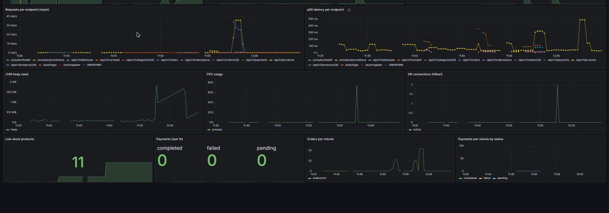

# E‑Commerce API

A **robust**, **scalable** Spring Boot backend for an online store, designed with modular layers, JWT security, and clean architecture.

---

## 🚀 Current Status

✓ **Java 17 & Spring Boot 3.2.x** core setup

✓ **JPA/Hibernate** integration with MySQL

✓ **Lombok** for boilerplate reduction

✓ **Security**
- JWT‑based auth: `/auth/register`, `/auth/login`
- Stateless sessions, custom `JwtFilter`, protected `/api/**`

✓ **API Layers**
- **Entities**, **DTOs**, **Mappers**
- **Repositories**, **Services**, **Controllers**

✓ **Cart**
- `POST /api/carts/add`: idempotent add/update quantity
- `GET /api/cart?userId={id}`: returns `ProductInCartDto` (product details + quantity)

✓ **Orders**
- `POST /api/orders/place`: single endpoint builds `Order` + `OrderItem`s from cart & clears cart
- Supports linking user address

✓ **Address Management**
- `POST /api/addresses`: create addresses for users
- Orders now reference `address_id` for delivery

✓ **Swagger/OpenAPI**
- Live docs: `http://localhost:9090/swagger-ui/index.html`

✓ **Monitoring (Prometheus + Grafana)**
- Spring Boot Actuator + Micrometer metrics at `/actuator/prometheus`
- Custom business metrics: orders, payments, low stock
- Ready-made Grafana dashboard (see [Monitoring](#-monitoring))

---

## 🚀 Quick Start (Docker, one command)

Runs the API, PostgreSQL, RabbitMQ, Prometheus and Grafana together. You only need **Docker Desktop**.

```bash
cp .env.example .env              # then paste a key after JWT_SECRET_KEY= (openssl rand -base64 32)
docker compose up -d --build      # first run takes a few minutes
```

| What | Where |
|------|-------|
| API | http://localhost:8080 |
| Grafana (`admin` / `admin`) | http://localhost:3000 |
| Prometheus | http://localhost:9090 |
| RabbitMQ (`guest` / `guest`) | http://localhost:15672 |
| PostgreSQL (from your machine) | `localhost:5433`, db `ecommerce`, user `postgres` |

Stop with `docker compose stop`. Full guide: [docs/monitoring-setup.md](docs/monitoring-setup.md).

---

## ⚙️ Prerequisites (running without Docker)

- Java 17+
- Maven 3.6+
- PostgreSQL (running & accessible, database `ecommerce`)
- RabbitMQ (set `SPRING_RABBITMQ_HOST=localhost`)

---

## 🔧 Setup Guide

1. **Clone & configure**
   ```bash
   git clone https://github.com/shihabmi7/E-commerceAPI.git
   cd E-commerceAPI
   ```
2. **Configure secrets**

   Copy `.env.example` to `.env` and fill in real values — never hardcode secrets in
   `application.properties`. The JWT signing key is **required** (the app fails fast on
   startup if it's missing):
   ```bash
   cp .env.example .env
   # generate a signing key and paste it into .env as JWT_SECRET_KEY=
   openssl rand -base64 32
   ```
   Then export the vars into your shell before running locally (or let `docker-compose`
   pick them up from `.env` automatically):
   ```bash
   export $(cat .env | xargs)
   ```
3. **Database**

   Create an empty PostgreSQL database named `ecommerce`. Tables are created automatically on startup.
4. **Build & run**
   ```bash
   mvn clean install
   mvn spring-boot:run
   ```
5. **Explore**
    - Swagger UI: `http://localhost:9090/swagger-ui/index.html`
    - Test via Postman or cURL

---

## 📖 API Overview

### Authentication (no token)
| Endpoint            | Method | Description                |
|---------------------|--------|----------------------------|
| `/auth/register`    | POST   | Create new user            |
| `/auth/login`       | POST   | Authenticate & return JWT  |

### Cart
| Endpoint                       | Method | Description                                |
|--------------------------------|--------|--------------------------------------------|
| `/api/carts/add`               | POST   | Add/update product in user’s cart          |
| `/api/cart?userId={userId}`    | GET    | List products in cart with aggregated qty  |

### Orders
| Endpoint                       | Method | Description                                              |
|--------------------------------|--------|----------------------------------------------------------|
| `/api/v1/orders/place`         | POST   | Convert user’s cart into order + items, then clear cart. Body: `{"userId":1,"addressId":1}` |

### Addresses
| Endpoint                 | Method | Description                 |
|--------------------------|--------|-----------------------------|
| `/api/addresses`         | POST   | Add a new address for user  |

_(And other CRUD endpoints under `/api/` for users, products, categories, etc.)_

---

## 📊 Monitoring

The app exposes metrics with **Spring Boot Actuator + Micrometer**. **Prometheus** collects them and **Grafana** shows them on a dashboard.

```
Spring Boot app  →  Prometheus (:9090)  →  Grafana (:3000)
```



> 📘 **New to this?** Follow the simple step-by-step guide: [How to set up Prometheus and Grafana](docs/monitoring-setup.md)

### Run it locally

Everything at once: `docker compose up -d --build` (see [Quick Start](#-quick-start-docker-one-command)). Or, to run only the app from IntelliJ / `./mvnw spring-boot:run`:

1. Start the infrastructure and point Prometheus at your machine:
   ```bash
   PROMETHEUS_CONFIG=prometheus-host.yml docker compose up -d postgres rabbitmq prometheus grafana
   ```
2. Start the app with `JWT_SECRET_KEY`, `SPRING_DATASOURCE_URL=jdbc:postgresql://localhost:5433/ecommerce`, `SPRING_DATASOURCE_PASSWORD=postgres` and `SPRING_RABBITMQ_HOST=localhost` set.
3. Check the metrics endpoint: `curl http://localhost:8080/actuator/prometheus`
4. Open **Prometheus targets**: http://localhost:9090/targets (`ecommerce-api` should be **UP**).
5. Open **Grafana**: http://localhost:3000 (login `admin` / `admin`) → Dashboards → **E-Commerce API**.
6. Send some requests (Swagger UI, place an order, create a payment) and watch the graphs move.

> `monitoring/prometheus.yml` scrapes the `springboot-app` container (default). `monitoring/prometheus-host.yml` scrapes an app running on your machine.

### Custom business metrics

| Metric | Type | Meaning |
|--------|------|---------|
| `orders_placed_total` | Counter | Orders placed through `POST /api/orders/place` |
| `payments_total{status,method}` | Counter | Payments saved, by status (`pending`, `completed`, `failed`) and method |
| `products_low_stock` | Gauge | Products with stock below `app.inventory.low-stock-threshold` (default 5) |

### Dashboard panels

App up, orders placed, request rate, 5xx error rate, requests per endpoint, p95 latency, JVM heap, CPU, DB connections, low-stock products, payments by status, orders per minute.

### Files

- `monitoring/prometheus.yml` / `prometheus-host.yml`: what Prometheus scrapes (app in Docker / app on your machine)
- `monitoring/grafana/provisioning/`: Grafana data source and dashboard loader
- `monitoring/grafana/dashboards/ecommerce-api.json`: the dashboard

> `/actuator/health` and `/actuator/prometheus` are public for local use. Protect them before a public deployment.

---

## 🛠 Next Steps

- **RabbitMQ** integration for async order/event messaging
- **Firebase FCM** for real‑time push notifications (order status updates)
- Unit & integration tests (JUnit + Mockito)
- ~~Docker Compose~~ ✓ (`docker compose up -d --build` runs everything)
- Grafana alerts (high error rate, low stock)
- CI/CD pipeline (GitHub Actions → AWS)

---

## Docker Command

- mvn clear package [CREATE JAR]
- docker build -t image_name .  [From project root folder]
- docker run -p 5555:8080 -e JWT_SECRET_KEY=$(openssl rand -base64 32) ecommerce-api
- http://localhost:5555/swagger-ui/index.html
- docker images
- docker ps


## 👍 Contributing

1. Fork repo
2. Create feature branch
3. Open Pull Request

---

**MIT License © 2025**

