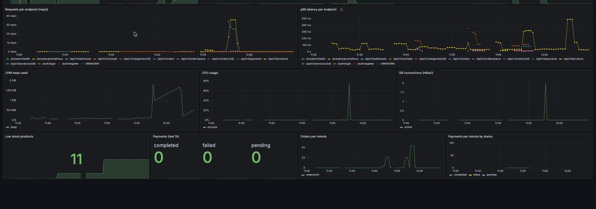

# How to Set Up Prometheus and Grafana

A simple guide. Follow the steps in order. It takes about 5 minutes.



## What are these tools?

| Tool | What it does | Address |
|------|--------------|---------|
| **Spring Boot app** | Your API. It shares numbers about itself (requests, orders, memory...) | http://localhost:8080/actuator/prometheus |
| **Prometheus** | Collects those numbers every 5 seconds and stores them | http://localhost:9090 |
| **Grafana** | Draws the numbers as nice graphs | http://localhost:3000 |

```
Your app  -->  Prometheus  -->  Grafana (you look here)
```

You do **not** install Prometheus or Grafana by hand. Docker runs them for you.

## Before you start

You need:
- **Docker Desktop**, installed and running
- **Java 17+** (to run the app)
- **PostgreSQL** running, with a database called `ecommerce`
- The project downloaded on your computer

## Step 1: Start the app

The app needs a secret key for login tokens. Make one and start the app:

```bash
export JWT_SECRET_KEY=$(openssl rand -base64 32)
export SPRING_RABBITMQ_HOST=localhost
./mvnw spring-boot:run
```

Using IntelliJ instead? Open **Run > Edit Configurations** and add these under
**Environment variables**:

```
JWT_SECRET_KEY=<any long random text>;SPRING_RABBITMQ_HOST=localhost
```

Check it works. This should print lots of text (not an error):

```bash
curl http://localhost:8080/actuator/prometheus
```

## Step 2: Start Prometheus, Grafana and RabbitMQ

Open a **new terminal** in the project folder and run:

```bash
docker compose up -d prometheus grafana rabbitmq
```

The first time, Docker downloads the images. Wait until it finishes.

> RabbitMQ is the message queue the app uses. Without it you will see
> connection errors in the app console.

## Step 3: Check Prometheus can see your app

1. Open http://localhost:9090/targets
2. Find `ecommerce-api`. The state should be green and say **UP**.

If it says **DOWN**, see [Problems and fixes](#problems-and-fixes) below.

## Step 4: Open Grafana

1. Open http://localhost:3000
2. Log in with username `admin` and password `admin`. (Grafana may ask you to
   change the password. You can click **Skip**.)
3. Click **Dashboards** in the left menu, then **E-Commerce API**.

Direct link: http://localhost:3000/d/ecommerce-api/e-commerce-api

The dashboard is already set up. You do not need to create anything.

## Step 5: Make the graphs move

A new app has no traffic, so the graphs look flat. Send some requests.
Copy and paste these into a terminal, one block at a time.

**1. Create a test user and log in** (saves your login token in `TOKEN`):

```bash
curl -X POST localhost:8080/auth/register -H 'Content-Type: application/json' \
  -d '{"fullName":"Test User","email":"test@example.com","password":"Passw0rd!"}'

TOKEN=$(curl -s -X POST localhost:8080/auth/login -H 'Content-Type: application/json' \
  -d '{"email":"test@example.com","password":"Passw0rd!"}' | sed 's/.*"token":"\([^"]*\)".*/\1/')
```

**2. Send 200 requests** (request rate, latency and endpoint graphs move):

```bash
for i in $(seq 1 200); do
  curl -s -o /dev/null -H "Authorization: Bearer $TOKEN" localhost:8080/api/v1/products
done
```

**3. Create a product with low stock** ("Low stock products" goes up):

```bash
curl -X POST localhost:8080/api/v1/products -H "Authorization: Bearer $TOKEN" \
  -H 'Content-Type: application/json' -d '{"name":"Test Product","price":9.99,"stock":2}'
```

**4. Place an order** ("Orders placed" goes up). An order needs a user, an
address and an item in the cart. Use your real ids in place of `1`:

```bash
# address
curl -X POST localhost:8080/api/v1/addresses -H "Authorization: Bearer $TOKEN" \
  -H 'Content-Type: application/json' \
  -d '{"user":{"id":1},"street":"1 Main St","city":"Dhaka","country":"BD","postalCode":"1200"}'

# add a product to the cart
curl -X POST localhost:8080/api/v1/cart/add -H "Authorization: Bearer $TOKEN" \
  -H 'Content-Type: application/json' -d '{"userId":1,"productId":1,"quantity":1}'

# place the order
curl -X POST localhost:8080/api/v1/orders/place -H "Authorization: Bearer $TOKEN" \
  -H 'Content-Type: application/json' -d '{"userId":1,"addressId":1}'
```

Wait a few seconds and look at Grafana again. The numbers change.

## What the panels mean

| Panel | Meaning |
|-------|---------|
| App up | 1 = the app is running, 0 = it is down |
| Orders placed (total) | Orders placed since the app started |
| Request rate | How many requests per second the app gets |
| Error rate (5xx) | Server errors per second. Should be 0 |
| Requests per endpoint | Which URLs are used most |
| p95 latency | How slow the slowest 5% of requests are |
| JVM heap / CPU | Memory and processor use of the app |
| DB connections | Database connections in use |
| Low stock products | Products with stock below 5 |
| Payments | Payments by status: completed, failed, pending |
| Orders per minute | How fast orders are coming in |

## Stop everything

```bash
docker compose stop prometheus grafana rabbitmq
```

Then stop the app (Ctrl+C in its terminal, or the red square in IntelliJ).

To start again later, repeat Step 1 and Step 2. Your Grafana setup is kept.

## Problems and fixes

**Prometheus target is DOWN**
- Is the app running? Check http://localhost:8080/actuator/health
- Running the app **inside Docker** instead of on your computer? Open
  `monitoring/prometheus.yml` and change `host.docker.internal:8080` to
  `springboot-app:8080`.

**Grafana graphs are empty**
- Set the time range (top right) to **Last 15 minutes**.
- Send some requests (Step 5). No requests means no graph lines.
- Make sure Prometheus is UP (Step 3).

**"Orders placed" shows 0 after I restarted the app**
- This is normal. The counter lives in the app's memory, so it starts from 0
  every time the app restarts.

**The app fails with `Could not resolve placeholder 'JWT_SECRET_KEY'`**
- You forgot to set `JWT_SECRET_KEY`. See Step 1.

**The console shows `UnknownHostException: rabbitmq`**
- Set `SPRING_RABBITMQ_HOST=localhost` and make sure RabbitMQ is running (Step 2).

**Port already in use (8080, 3000 or 9090)**
- Something else is using that port. Stop the other program, or stop the second
  copy of the app you started by mistake.

## Where are the files?

| File | What it is |
|------|------------|
| `docker-compose.yml` | Starts Prometheus and Grafana |
| `monitoring/prometheus.yml` | Tells Prometheus where to collect numbers from |
| `monitoring/grafana/provisioning/` | Connects Grafana to Prometheus automatically |
| `monitoring/grafana/dashboards/ecommerce-api.json` | The dashboard itself |
